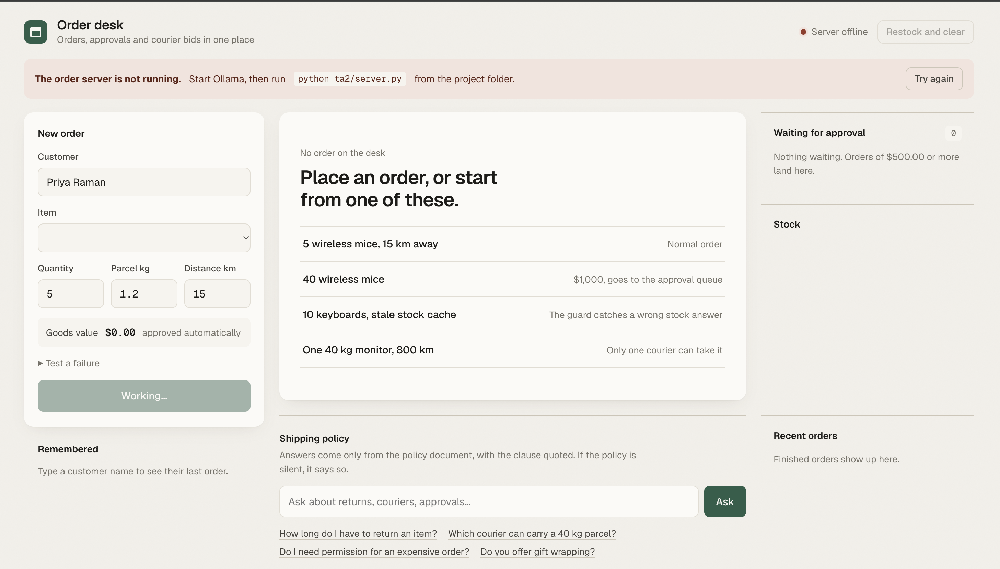

# Order Fulfillment System

A multi-agent order fulfillment workflow built with **LangGraph**, **Ollama (qwen2.5:3b)**, **SQLite**, **RAG** and courier bidding. It compares a fixed Jury-1 baseline (TA1) with the Jury-2 system (TA2).

## Dashboard



## Results

Same 5 test cases run on both systems, each on a fresh database.

| Metric | TA1 | TA2 |
|---|---|---|
| Cases passed | 1/5 | 5/5 |
| Accuracy | 20% | 100% |
| Cases leaving negative stock | 1 | 0 |
| Mean latency per case | 27.2 ms | 42.7 ms |

33 unit tests pass (`python -m unittest -v test_graph`).

## Features

- SQLite inventory, orders, shipments and checkpoints
- Checkpointer: resume an interrupted order without re-running earlier nodes
- RAG over the shipping policy (BM25); says "I don't know" when the policy is silent
- Inventory, Shipping, Order and Policy agents coordinated by a Supervisor with a max-hops limit
- Contract-net courier bidding (cheapest eligible courier wins)
- Human approval for orders of $500 or more
- Short-term and long-term memory
- Error propagation demo: a wrong inventory answer is caught at the source and guarded at commit

## Setup (Mac)

```bash
python3 -m venv venv && source venv/bin/activate
pip install -r requirements.txt
brew install ollama && brew services start ollama
ollama pull qwen2.5:3b
ollama pull nomic-embed-text
```

## Run

Tests and evidence files:

```bash
python -m unittest -v test_graph
python "order_fulfillment_graph (1).py" > annotated_traces_output.txt
python jury2_demo.py > jury2_evidence.txt
python evaluate.py > evaluation_results.txt
```

Dashboard (two terminals):

```bash
python server.py                              # API on http://localhost:8000
cd frontend && npm install && npm run dev     # UI on http://localhost:5173
```

Set `ORDER_USE_LLM=1` to include the LLM in the evaluation (off by default so results are repeatable).

## Project layout

- `order_fulfillment/`: nodes, graph, agents, store, RAG, memory, supervisor
- `server.py`: HTTP API for the UI
- `frontend/`: React + Vite dashboard
- `evaluate.py`, `jury2_demo.py`, `test_graph.py`: evaluation, evidence, tests
- `ta1/`, `ta2/`, `traces/`: Jury-1 baseline, 120-line TA2 prototype, saved outputs
- `JURY_PREP.md`: answers to likely jury questions
